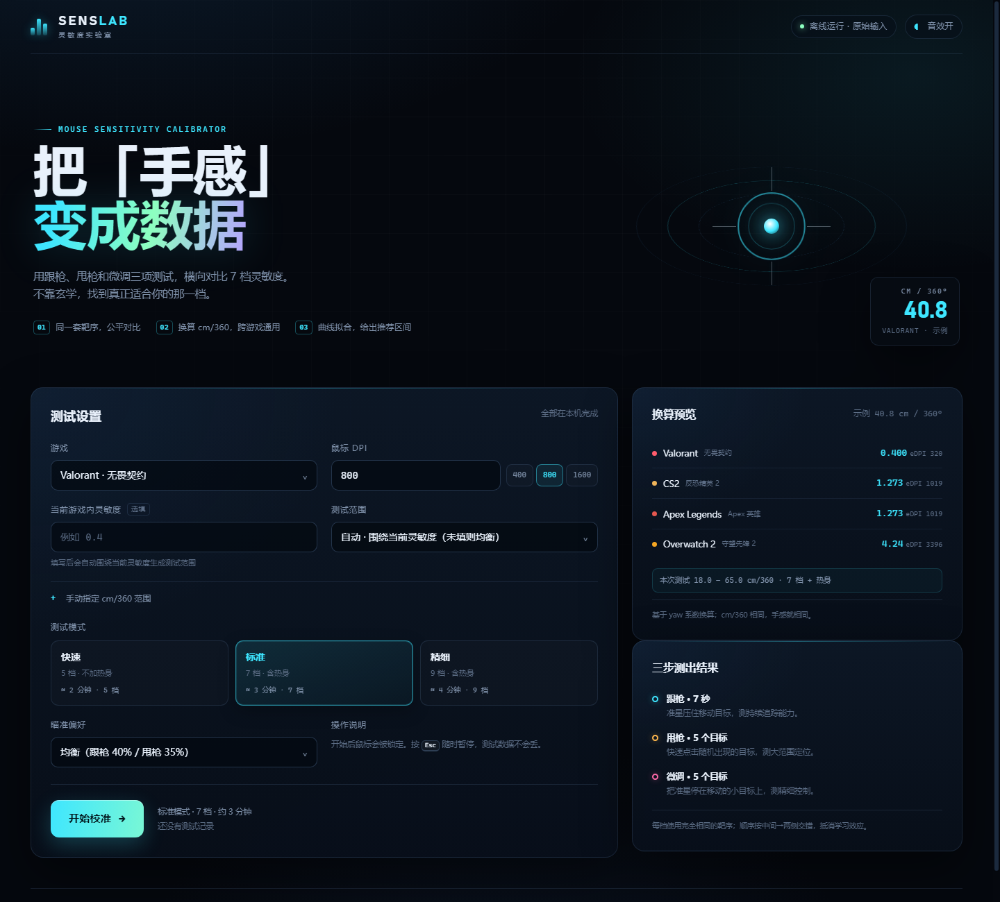
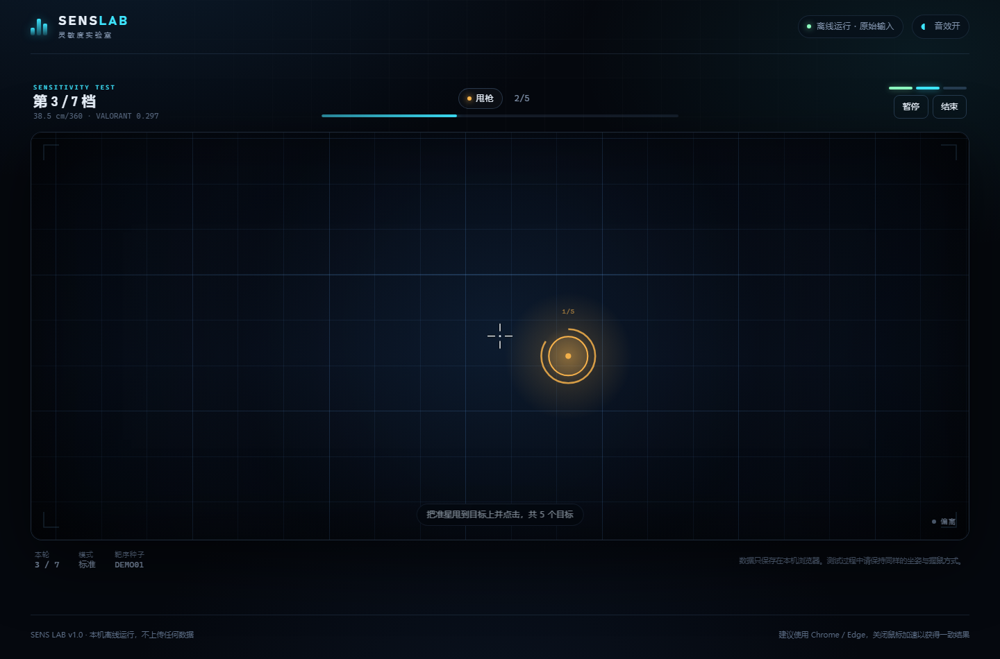
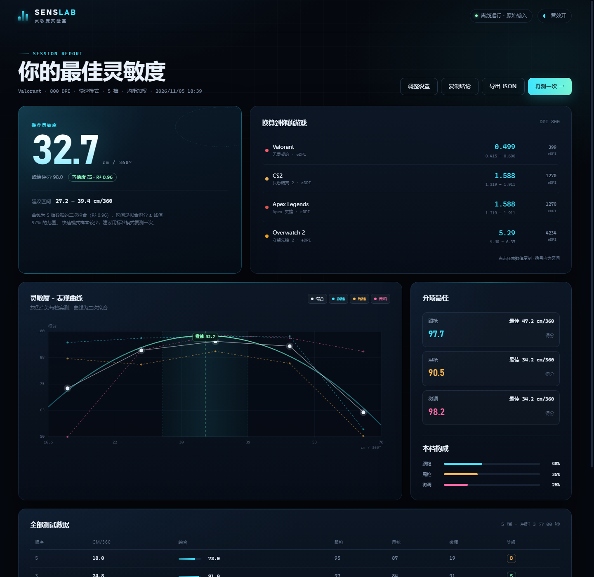

# SENS LAB · 灵敏度实验室

一个纯前端、离线可用的 FPS 鼠标灵敏度检测器。通过**跟枪（Tracking）**、**甩枪（Flick）**和**微调（Micro-adjust）**三项测试，横向对比多档灵敏度，用二次拟合找出表现最好的 cm/360，并换算成 Valorant、CS2、Apex、Overwatch 2 的游戏内数值。

项目路径：`D:\Dev\dsh-workspace\sens-finder`



## 特点

- **三项测试，一个结论**：跟枪 40% + 甩枪 35% + 微调 25%（可在设置里切换瞄准偏好权重）。
- **公平对比**：每档灵敏度使用完全相同的靶序（同一随机种子）；测试顺序按「中间 → 两侧」交错，抵消学习效应；标准/精细模式额外有一轮独立靶序的热身。
- **物理单位**：以 cm/360° 为横轴，同时给出游戏内灵敏度与 eDPI，跨游戏可迁移。
- **数据化推荐**：`得分 = f(ln cm/360)` 二次拟合，给出峰值、建议区间、置信度和 R²；得分过于接近时会明确标注「区分度低」。
- **原始鼠标输入**：使用 Pointer Lock 的 `unadjustedMovement`，绕过系统鼠标加速；浏览器拒绝锁定时可降级为页面内鼠标模式。
- **无依赖、无构建、无上传**：原生 HTML/CSS/JS，双击即可运行；数据只存在本机 `localStorage`。





## 快速开始

### 方式一：本地静态服务器（推荐）

```powershell
cd D:\Dev\dsh-workspace\sens-finder
node scripts/serve.mjs
# 打开 http://127.0.0.1:4173
```

### 方式二：直接打开

双击 `index.html`（Chrome / Edge）。`file://` 下大部分功能可用，但个别浏览器的 Pointer Lock、剪贴板权限更严格；若无法锁定鼠标，页面会提供降级模式。

### 测试前设置

1. 选择游戏、填写鼠标 **DPI**（100–32000）。
2. 可选：填写当前游戏内灵敏度，测试范围会自动围绕它展开（±约 20% 弧长）；不填则使用 18–65 cm/360 的均衡范围。
3. 选择模式：快速 5 档 / 标准 7 档 / 精细 9 档；选择瞄准偏好（均衡、跟枪、甩枪、微调）。
4. 点击「开始校准」，浏览器请求锁定鼠标，倒计时后开始。

### 操作

| 操作 | 说明 |
| --- | --- |
| 移动鼠标 | 转动视角，准星始终在屏幕中央 |
| 鼠标左键 | 甩枪阶段点击目标（点空会计入轻微惩罚） |
| `Esc` / `P` | 暂停 / 继续（暂停后指针解锁） |
| 画面上「结束」 | 带着已完成的数据提前看结果 |

建议关闭 Windows「提高指针精确度」（鼠标加速），保持指针速度为默认 6/11，并在整个测试中保持相同坐姿、握法和手臂/手腕发力方式。

## 测试内容

| 阶段 | 时长 / 数量 | 目标 | 计分 |
| --- | --- | --- | --- |
| 跟枪 | 5–8 秒 | 2.8° 半径、做平滑双正弦运动的球 | 逐帧贴合质量 65% + 在靶时间占比 35% |
| 甩枪 | 4–6 个 | 2.6° 半径、随机出现在 ±36° 内的目标，存活 1.8 秒 | 每次命中 60% 精准度 + 40% 速度；未命中为 0；点空扣分 |
| 微调 | 4–6 个 | 1.2° 半径、缓慢漂移的小目标，需停留 0.5 秒 | 成功率为主，完成越快分数越高；超时为 0 |

标准模式总时长约 3 分钟，快速约 2 分钟，精细约 4 分钟。中途可以随时暂停，计时会停止。

## 推荐算法

### 1. 换算

游戏内灵敏度 `sens` 与 cm/360° 的关系（yaw = 灵敏度为 1 时每个鼠标计数转过的角度）：

```
sens       = 914.4 / (DPI × yaw × cm360)
cm360      = 914.4 / (DPI × yaw × sens)
```

| 游戏 | yaw (°/count) | 说明 |
| --- | --- | --- |
| Valorant | 0.07 | 无畏契约 |
| CS2 | 0.022 | 反恐精英 2 |
| Apex Legends | 0.022 | 与 CS2 同基准 |
| Overwatch 2 | 0.0066 | 守望先锋 2 |

> yaw 基准与换算公式参考 [Sens Converter — Why yaw matters](https://sensconverter.org/guides/why-yaw-matters/)。

测试中每个鼠标计数对应的视角旋转为：

```
degPerCount = 360 / (DPI / 2.54 × cm360)
```

例如 800 DPI、40 cm/360 时约 `0.0286°/count`。FOV 只影响画面投影和目标像素大小，命中判定使用角度，因此同一 cm/360 在不同游戏配置下难度基本一致。

### 2. 拟合与区间

把每档的 `(cm/360, 综合得分)` 变换到对数横轴，最小二乘拟合二次曲线 `score = a·u² + b·u + c`，`u = ln(cm360) - mean`：

- 峰值取 `u* = -b / 2a`（要求 `a < 0` 且落在实测范围内），否则退化为实测最高档。
- 建议区间是拟合得分 ≥ 峰值 97% 的范围，与实测范围取交集。
- 置信度综合 R²、最高两档的分差和样本量；使用实测最高档时会额外降级。
- 若各档得分标准差 < 2 或峰值 < 5，标记为「区分度低」，只作为参考值，不写入历史记录。

### 3. 公平性

- 每轮使用同一个靶序种子，目标位置、运动路径和存活时间完全一致。
- 测试顺序不是从小到大，而是从中间向两侧交错，避免越测越熟练造成的偏差。
- 热身使用单独的种子，不污染正式靶序，也不计入结果。

## 结果解读

- **cm/360** 是最可迁移的指标；建议先按推荐值调游戏，再去靶场微调 ±5%。
- **建议区间**表示统计上接近峰值的范围，不必精确到小数点。
- **分项最佳**告诉你跟枪、甩枪、微调各自偏好的灵敏度；如果三者差异很大，说明你的手感可能还没稳定，建议复测。
- 一次测试只有 5–9 个点，且受疲劳、热身、专注度影响；重要决定建议做 2–3 次，取稳定的那个区间。

## 数据与隐私

- `localStorage` 键：
  - `senslab.config.v1`：上次设置（游戏、DPI、模式、偏好、音效）。
  - `senslab.history.v1`：最近 10 次有效结论（推荐的 cm/360、评分、置信度、日期）。
- 没有任何网络请求，不上传成绩。
- 结果页支持「复制结论」和「导出 JSON」，方便自己存档或对比。

## 文件结构

```
sens-finder/
├─ index.html            页面结构（设置 / 测试 / 结果三个屏）
├─ styles.css            视觉与响应式布局
├─ src/
│  ├─ core.js            换算、靶序生成、评分、拟合（可在 Node 中单测）
│  ├─ engine.js          Canvas 测试引擎（相机、目标、命中、渲染）
│  └─ app.js             会话流程、Pointer Lock、结果图表、存储、自测
├─ test/core.test.js     Node 原生测试
├─ scripts/serve.mjs     零依赖静态服务器
└─ docs/                 截图
```

## 验证

```powershell
cd D:\Dev\dsh-workspace\sens-finder
node --test test/
```

另外内置了无头自测：

- `index.html?autotest=1`：用合成输入跑完一次快速模式（5 档），结果写入 `<html data-autotest="pass">` 和隐藏的 `#autotest-report`（JSON），可直接用 `--dump-dom` 检查。
- `index.html?demo=flick`：冻结在测试画面，便于截图 / 视觉检查。

## 已知限制

- 浏览器无法读取游戏引擎的原始输入。测试依赖 Pointer Lock 的 `movementX/Y`；如果系统鼠标加速未关闭、指针速度不是默认值，或浏览器拒绝了 `unadjustedMovement`，绝对 cm/360 会有偏差（相对比较仍然有效）。
- 触屏设备无法测试，设置页会提示。
- 目标尺寸和移动速度是固定的，不能替代游戏内的真实手感；本工具用于缩小候选范围，最终请结合游戏内死斗/靶场验证。
- 快速模式样本少，置信度通常低于标准/精细模式。
- 结果仅保存在当前浏览器；清理站点数据会丢失历史。
